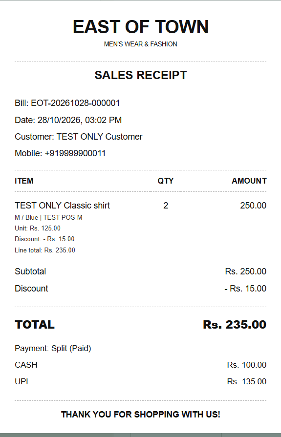
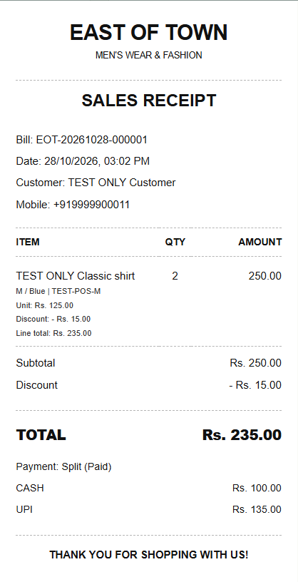

# Receipt design update — 28 October 2026

The saved-invoice preview, thermal receipt/reprint, invoice PDF and shared receipt PNG follow the supplied sales-receipt reference. Actual shop and customer details come from the saved invoice; the example business name, address, customer and invoice number in the reference are not copied into shop data.

The layout has a centered East of Town heading and men's-fashion subtitle, optional saved address/contact, SALES RECEIPT heading, bill/date/customer details, dashed separators, ITEM / QTY / AMOUNT columns, subtotal/discount/tax, bold TOTAL, payment details and a centered uppercase configured thank-you message. Custom shop names remain supported. Dates use India time and amounts use Rs. with two decimals.

AMOUNT is the item's quantity multiplied by its saved unit price, before discounts and tax, so that the column adds up to Subtotal. Variant, SKU and unit price remain readable beneath the name. Discount/tax adjustments and the saved net line total appear when applicable. Overall discounts include both line and bill discounts; configured tax is shown only when nonzero. No billing formula or stored financial value changes.

Split payments show each method's amount. Returned/cancelled invoices retain original totals and payments, explicitly label original payment, flag recorded reversals/refunds, and state that original totals are preserved. The original invoice status is not misrepresented as its current return/refund position. Guest and zero-total sales remain supported.

## Operation

1. Restart the source application after the updated backend and renderer are built.
2. Complete a bill, or open an existing invoice from Invoice history or Customer purchase history.
3. Select 80 mm or 58 mm to preview/save/reprint. Shop name, address, contact and footer are configured in Billing settings for future sales; historical invoices retain their saved details.
4. Use Save receipt PDF or either existing sharing route. Sharing uses the same 80 mm PDF layout; PNG is rendered from that PDF. A receipt spanning multiple pages must be shared as PDF.

The printer receives the same PDF at actual size. Physical paper margins, roll cutting and driver calibration still require the chosen printer. Barcode labels and their vertical orientation are unchanged.

## Architecture

`ReceiptLayout` handles presentation using PDFBox, measured text, embedded system regular/bold fonts, right-aligned amounts and a centered quantity column. Font files are not redistributed. The existing Arial/DejaVu/Helvetica fallback approach is retained, adding the corresponding bold face. There are no new dependencies or database migrations.

Receipt height grows with its content. Long receipts paginate with bill identification and page numbers. Item/detail blocks and total/payment blocks are kept together when they fit a page. Wrapping and amount sizing support both paper widths. `ReceiptService.pdf` supplies this layout to export, printing and the PNG endpoint. React's `ReceiptPaper` provides the equivalent screen layout with styles scoped to avoid the application's general header/table styles.

## Verification

- Full backend suite: 97 tests passed, including six new receipt layout tests. The refined pagination and PNG comparison were subsequently verified with 24 focused receipt/control tests.
- Snapshot amounts, example subtotal 3,497.00 / discount 200.00 / total 3,297.00, both widths, guest/zero total, custom/multiline shop details, split payments, tax, returns, long names, large amounts, page identification, item grouping and text bounds are checked.
- The actual authenticated PNG endpoint is compared pixel for pixel with a 150 dpi rendering of the invoice PDF.
- Renderer build, billing desktop and Stage 6 desktop regression passed in isolated test profiles. Desktop assertions cover the three columns, gross item amount, subtotal/net total, split payments and no column overflow at either width. A previously ambiguous payment-heading test now targets the review heading explicitly.
- PDF samples, return/split/tax output, long-receipt first/last pages and both final desktop previews were visually inspected. No customer messages or physical print jobs were sent by these tests.

## Samples — test data only

These static documentation samples are included in the repository and packaged resources. They are never inserted into the business database or reports.

- [80 mm PDF](../output/pdf/east-of-town-receipt-80mm.pdf)
- [58 mm PDF](../output/pdf/east-of-town-receipt-58mm.pdf)

