# Operating manual — version 0.2.0 (Stages 1 and 2)

For 80 mm POS thermal barcode printing, see [thermal printing instructions](THERMAL_PRINTING.md). Select the thermal roll layout in **Barcode labels** for automatic paper height.

## Launch and sign in

Close any running older copy before rebuilding or upgrading. In Command Prompt, use the repository root:

```cmd
cd /d C:\Ammu\EastOfTown\EastOfTownPOS-App
npm.cmd ci
npm.cmd run build
cd backend
mvn.cmd package
cd ..
npm.cmd start
```

The install/build commands are needed after cloning or receiving changes. Normal later launches require only `cd /d ...` and `npm.cmd start`. Java must be installed, or prepare the bundled runtime using the README. `test:api` is a verification command, not a launch requirement.

On first Stage 2 launch, create a local administrator. Choose a username with 3–40 letters/digits/dot/underscore/hyphen, and a password of at least 12 characters (maximum 72 UTF-8 bytes). The app displays a recovery code once after setup; save it securely. Existing Stage 1 products remain available after automatic migration. Sign in with this account; sign out when handing the computer to another operator. Sessions expire after eight hours or backend restart. After repeated failed logins or recovery attempts, wait a minute before trying again.

If the administrator forgets the password, select **Forgot administrator password?** on the sign-in screen. Enter the administrator username, the saved recovery code and a new password of at least 12 characters. The code is single-use and is cleared after a successful reset. After signing in, open **Users → Administrator recovery → Generate new recovery code** to replace a code that may have been exposed or to provision recovery for an existing Stage 1/early Stage 2 account. Store the newly displayed code securely; it is never stored in readable form and cannot be recovered from the database.

Administrators can create billing users in **Users**. Billing users can view catalog/inventory history and print labels. Product/category edits, Excel import, stock adjustments, user creation and label-preference changes require an administrator. These restrictions are checked by the backend as well as the interface.

## Products and categories — Stage 1

1. **Categories** shows the eight default categories and allows administrators to add names.
2. In **Products → Add variant**, enter name, category, unique SKU, size, colour and price. Cost is optional. Enter opening quantity and low-stock threshold.
3. Leave barcode blank to allocate a permanent internal value. Each size/colour has its own SKU/barcode/quantity. To add another variant to one product, select the existing product in the form.
4. Save, then search by product name, SKU or barcode and press Enter. Barcode appears below the SKU. A keyboard scanner can fill this search field; POS scan-to-bill starts in Stage 3.
5. **Edit** changes details/status. Product name/category are shared by sibling variants. Existing barcodes and stock cannot be changed here. Stale edits require refreshing.

## Excel stock import — Stage 2

1. Sign in as administrator and select **Excel import**.
2. **Download template** and choose a save location. Fill the Stock sheet with one variant per row; Instructions and Categories are reference sheets. Required columns: name, category, SKU, size, colour and price. Use text cells for SKU/barcode, plain decimal prices (no currency symbols or separators), whole quantities, and true/false for active. Leave barcode blank if missing. Do not use formulas.
3. **Choose Excel file**, select your .xlsx/.xls workbook, then review the suggested column mappings. Correct mappings as needed. Optionally assign one category to every row. New category names will be created only during confirmed import.
4. Choose the stock policy carefully:

| Policy | Meaning |
|---|---|
| Product details only | Ignore quantity. Existing stock stays unchanged; new variants start at zero. |
| Opening stock for NEW variants only | Use quantity for new variants. Existing quantities are ignored with a warning. |
| Authorized stock delta | Existing variants: +5 adds five, -2 removes two. New variants: non-negative opening quantity. Enter the reason. |

5. **Validate and preview**. Inspect action, stock change, errors and warnings. Use Previous/Next to inspect all pages. A repeated SKU within the file is an error; an existing database SKU means update. Changing its barcode is rejected. Name/category changes affect sibling variants. Blank cost clears a previous cost; blank threshold becomes 3; blank active preserves existing status.
6. **Export errors / warnings** for correction. If there are errors, correct the original workbook and upload again; the export lists problems rather than becoming a ready-to-import stock workbook. Nothing is saved while errors remain.
7. Review warnings and new categories, tick the confirmation checkbox, then **Confirm and save import**. See created/updated/skipped/failed counts and the saved history entry. If inventory changed after preview, generate a fresh preview and check it again.
8. Repeated confirmation of the same batch cannot add stock twice. Uploading the same file again creates a new batch; an intentional delta import will add its quantities again, so inspect history first.

Limits: first sheet only, 10 MB, 5,000 data rows, 64 columns. Blank rows are skipped. Invalid prices, quantities, missing fields, numeric SKU/barcode cells, duplicate identifiers and malformed workbooks are reported. Every confirmed batch is one transaction.

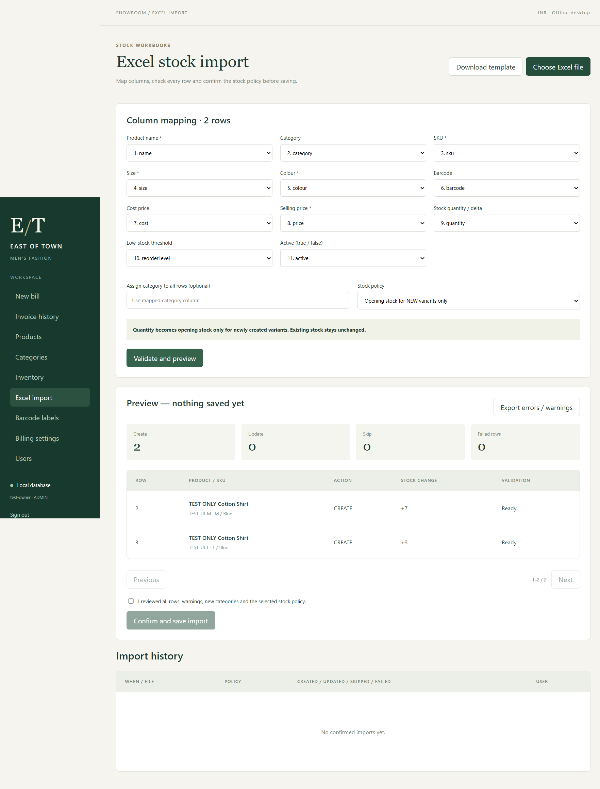

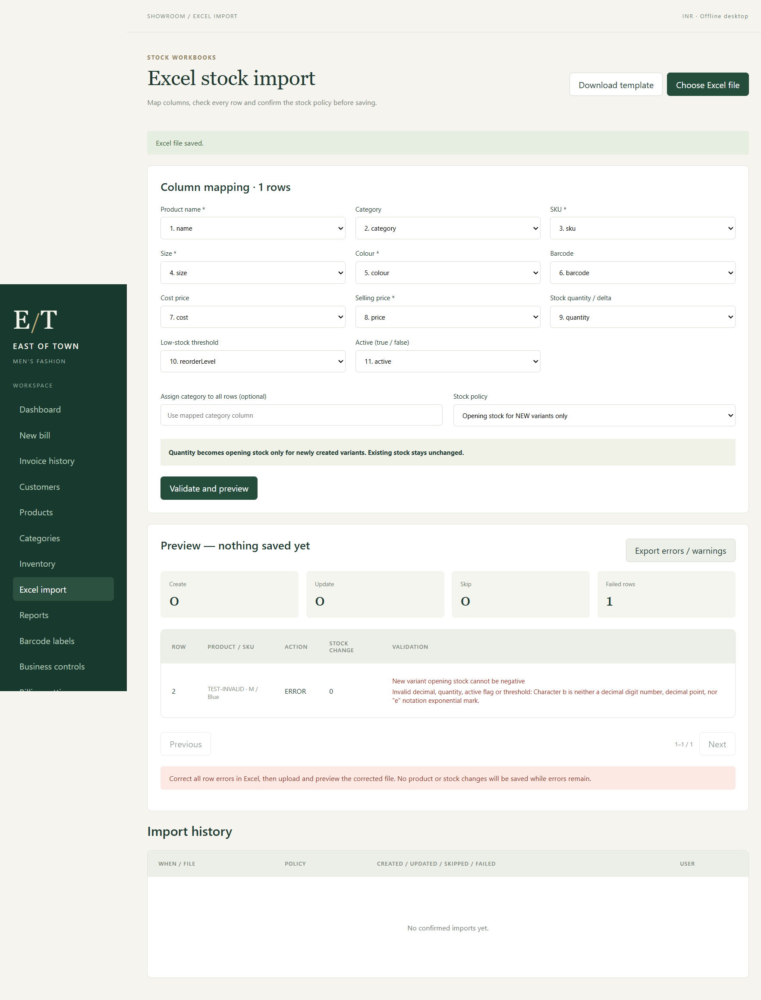

## Adjust existing stock

1. Choose **Inventory**, search for the exact SKU, then **Adjust stock**.
2. Enter signed units, effective date and a clear reason. Negative removes units; positive adds units. Future dates and negative resulting balances are rejected.
3. Check the displayed resulting balance and confirmation checkbox, then **Confirm adjustment**. If the balance changed, close the dialog, refresh inventory and try again.
4. **History** shows the most recent 500 movement entries, including opening/imported stock, adjustments, date, reason and operator. Correct mistakes with another documented adjustment; original movements are retained.

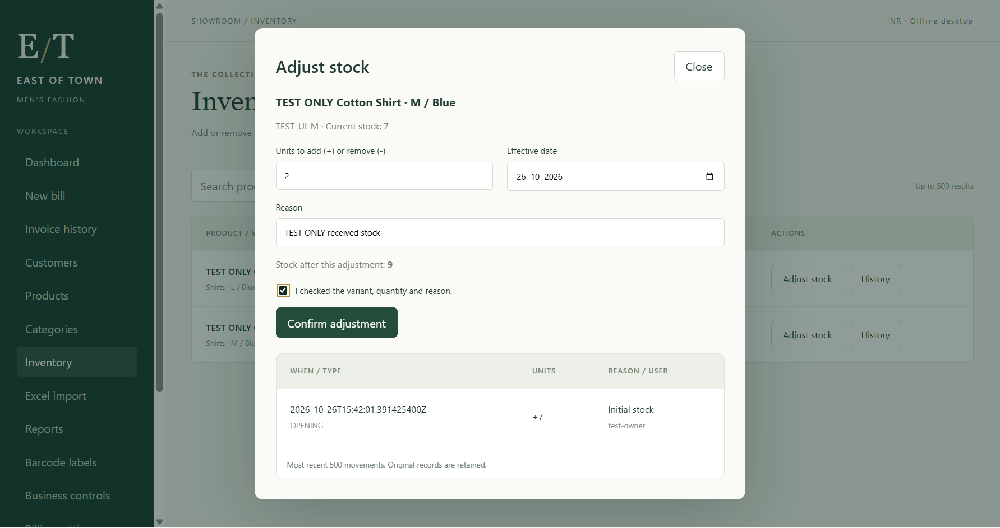

## Barcode labels

1. Choose **Barcode labels**, search and select active variants, then set copies.
2. Enter label width/height and choose an installed Windows printer. Administrators can **Save preferences**. Defaults are 80 × 40 mm; supported range is 35–110 mm wide and 25–100 mm tall.
3. **Preview labels** shows the PDF-rendered layout. It preserves the stored barcode. If a legacy barcode is too long for the label, increase label width. Maximum 50 variants / 200 copies per job.
4. **Save PDF** for an offline file, or **Print labels**. Use the same media dimensions in the Windows printer driver and print at actual size / 100%. **Test print** submits one marked test label to check calibration.
5. A submitted job means the Windows spooler accepted the request; check paper, alignment and physical output. If the printer is unavailable or a print call fails, save the PDF and resolve the driver/printer problem before retrying. A disconnected printer may accept a queued job; spool acceptance is not proof of a printed label.
6. Scan a physical label into the Products search box and verify the exact SKU/size/colour. Hardware calibration and barcode readability must be checked on your actual devices.

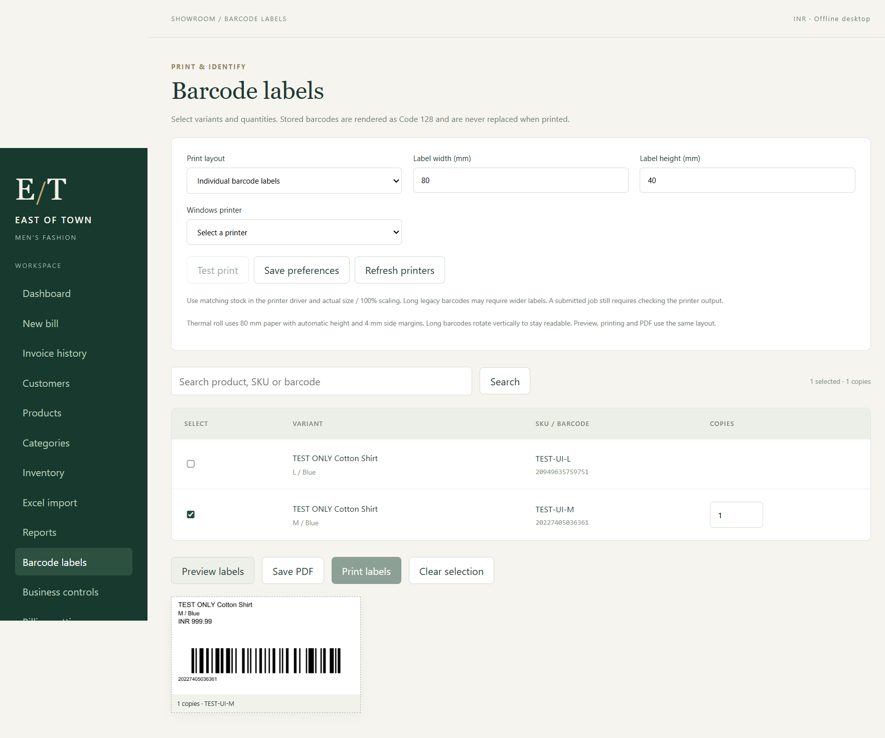

## Persistence, tests and troubleshooting

Business data is stored in the persistent application data directory described in README.md. Reopening the app keeps records. Do not delete the database to troubleshoot, copy only a live `.db` file without WAL, or enter real sales: backup/restore is not available yet.

For isolated desktop evaluation in Command Prompt:

```cmd
set EOT_TEST_PROFILE=C:\Ammu\EastOfTown\EastOfTownPOS-App\.test-desktop-profile
npm.cmd start
```

That development-only override separates test stock from the normal profile. `npm.cmd run test:api` and `npm.cmd run test:desktop` create separate temporary databases automatically. Automated tests do not require a physical printer and do not print real jobs. Check README.md and STAGE_2_TEST_RESULTS.md for verification commands.

Missing `dist/index.html`: run `npm.cmd run build`. Missing backend JAR: build `backend` with Maven. Missing Electron: run `npm.cmd ci`. Locked JAR: close the running app before rebuilding. Startup timeout/service errors: inspect `backend.log` in the data folder, retain the database and contact the developer with the error. A missing bundled Java runtime is not required for development if JAVA_HOME/PATH Java is installed. Unsigned installers may be blocked by Smart App Control; trusted signing remains a release task.

Full customer histories, sales reports, returns and backup/restore remain Stages 4–6. POS billing and receipts are available in Stage 3. See STAGES.md for the complete status index.

## Stage 3 — billing and receipts

1. Sign in and choose **New bill**. Press F2 to focus **Barcode scan**. Scan a label and let the scanner send Enter. The exact size/colour variant is added; scanning it again increments that line. Product search also finds name, SKU or barcode; select a result to add it.
2. Change quantity or **Remove** an item. Enter line discount as an amount for the whole line, and optionally a bill discount in INR. Administrators control billing-user discount limits in **Billing settings**. Default billing-user discount allowance is 0%.
3. Use guest checkout, search name/mobile to select an existing customer, or **Create customer**. A duplicate mobile prompts selection of the existing customer.
4. Press F9 or **Review bill and payment**. Review product/variant, unit price, quantities, allocated discounts, tax and final payable. The backend calculates these values. If catalog prices, tax or stock changed, correct/review again.
5. Choose Cash, UPI, Card or Split payment. For split payment, enter the applied amounts; they must exactly equal payable. Optional cash tendered shows change; only the applied invoice amount is recorded as cash collection.
6. After receiving payment, choose **Payment received — save invoice** once. The invoice number is assigned and stock/payments commit together. The app records your confirmation; it does not charge a card or verify UPI with a bank.
7. The **Saved invoice** dialog supports **Save receipt PDF** and **Print / reprint receipt**, with 58 or 80 mm width and an installed printer. Automatic printing can be enabled in billing settings. A print error leaves the invoice saved; use PDF or reprint later.
8. If checkout confirmation was interrupted, return to New bill and use **Check checkout status** or **Retry same checkout**. The saved request key prevents another stock deduction. If no sale was saved, the status check releases that request for a fresh review. Check status before starting another bill.

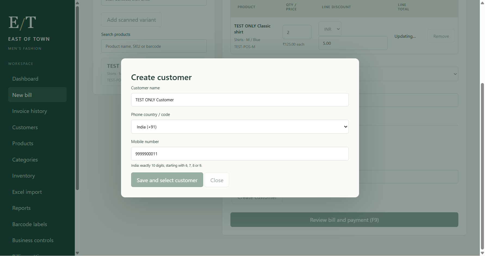

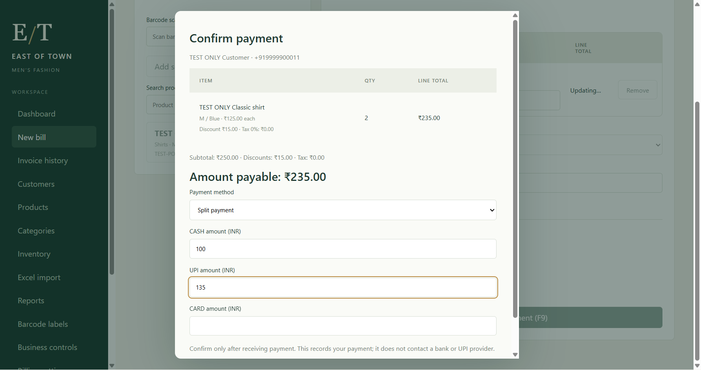

### Previous invoices
Choose **Invoice history**. Search by invoice/customer/mobile, date range or exact INR total. **View invoice** shows the historical product, prices, discounts, tax and payments; print again or save PDF. Catalog/customer corrections do not alter old receipts. The screen shows the most recent 500 matching invoices.

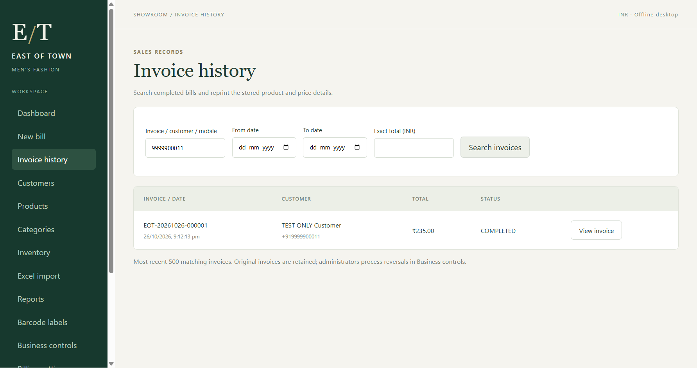

### Billing settings (administrator)
Enter shop address/contact/footer, numbering prefix, billing-user maximum combined discount, paper width and printer. **Save billing settings**, then **Test receipt printer**. Choose actual size / 100% scaling and matching paper in the Windows driver. Spool submission is not proof of physical output; check the paper.

Tax defaults to 0%. In **Variant tax configuration**, find/select the exact SKU, enter your required percentage and save. Each variant can use a different rate. Tax is added to the discounted selling amount and rounded per line. Existing completed invoices keep their original tax.

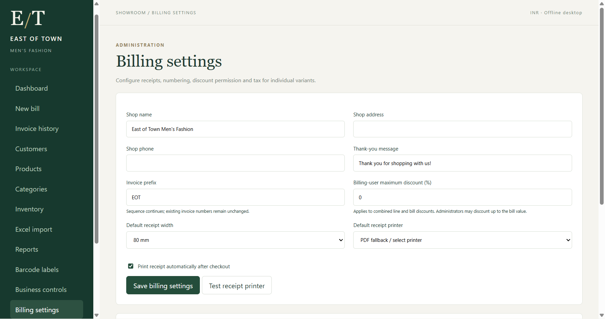

Full customer history/reports are implemented in Stage 4 below. Returns/cancellations/refunds and backup/restore remain Stage 5; completed invoices cannot currently be deleted or reversed. Keep evaluation/test records in the separate test profile until final release acceptance.

## Stage 4 — customers and reports

### Find a customer and view purchases

1. Select **Customers** in the sidebar. Search the customer's name or digits-only mobile and choose **Search customers**.
2. The list shows completed purchase count, total amount including tax, last purchase and last invoice. Use **Previous customers / Next customers** for more records.
3. Choose **Purchase history**. Every invoice linked to the permanent customer ID is available through the purchase paging buttons.
4. Choose **View purchase details** for original products, size/colour, quantities, prices, discounts, tax and payments. Print/reprint or save the receipt using the existing receipt buttons.
5. For a new customer, choose **Add customer**, enter name/mobile and optional email, use **Check similar customers**, then **Save customer**. An existing mobile is rejected; select the existing record. People with the same name may be different customers, so name matches are warnings.

Administrators can choose **Correct customer details**, correct name/mobile/email and save. Original invoices keep the customer details saved at sale, while purchases remain linked to this customer's ID. **View correction audit** shows before/after details and the administrator/time. If a stale-edit error appears, reopen the history and make the correction again. Billing users can create/view customers but cannot correct them.

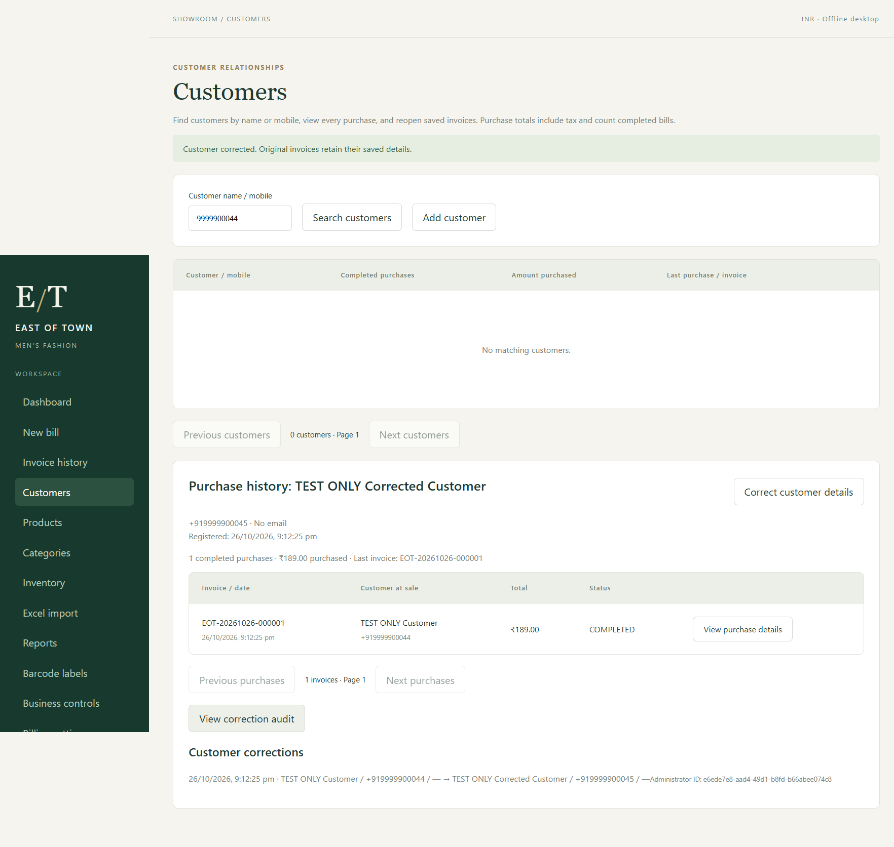

### Dashboard (administrator)

1. Select **Dashboard**, choose the date preset and press **Apply dates / refresh**. For **Custom range**, fill both dates first. Dates use Indian time; the financial year begins April 1 and this week begins Monday.
2. Gross sales are before discounts/tax. Net sales subtract all discounts and exclude tax. Invoice value includes tax. Collections show applied payments by method; cash change is excluded. Average bill includes tax.
3. Stock units and cost valuation are CURRENT, independent of the sales period, and include inactive stock. Units missing cost are shown separately. Low/out-of-stock alerts include active variants only. Alerts show up to 20 rows; use the inventory report for the full list.
4. Recent invoices open the saved receipt. Bestsellers show variants and quantities sold within the selected period.

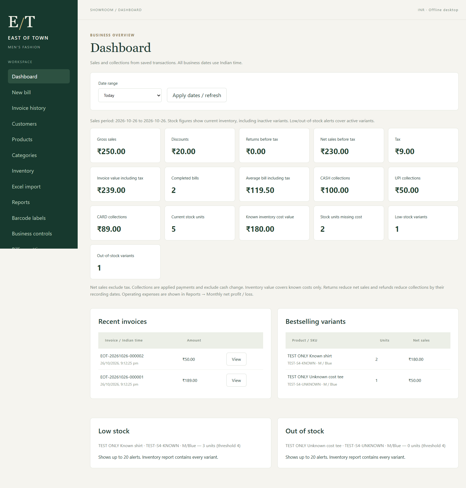

### Reports and Excel/PDF export (administrator)

1. Select **Reports**. Choose daily/monthly/yearly sales, product/category/variant sales, payments, stock movements, current inventory valuation, gross profit estimates, customer purchases or individual purchase history.
2. Choose the date range and press **View report**. Individual purchase history also requires **Find customer** and customer selection.
3. Review the period and accounting note. **Export Excel** or **Export PDF** opens Windows Save As. Choose a location and save; a success message appears only after the file is written.
4. Exports use the most recently applied filters and the latest saved database records. Use **View report** again when you change filters. An invoice committed after the preview may appear in a later export.
5. Excel has a filterable/frozen table and a **Read me** sheet. Amounts are INR. Unknown costs remain blank. PDFs use landscape A4/A3 depending on the number of columns and repeat headers on additional pages.

Inventory valuation always uses current stock and current cost. Profit estimates use cost saved at sale and exclude tax, operating expenses and lines with missing costs; missing-cost quantities are shown. Customer-report payment descriptions repeat for each item in the same invoice, so do not sum those descriptions. Stock reports filter the recording date and display an adjustment's effective date separately.

If a report exceeds 20,000 source records, choose a shorter period. Reports reject overly large selections instead of silently omitting records. Customer screen history remains fully paged. Return/refund reporting will be added with Stage 5; do not manually delete/change invoices in SQLite.

## Stage 5: business controls (version 0.5.0)

Sign in as Administrator. Open **Business controls**; its tabs are Returns, Expenses, Backup and restore, and User access. Scroll the sidebar to reach lower links and Sign out on shorter windows.

### Discounts in percentage or rupees

In **New bill**, each product line has an INR/% selector. Select the unit, then enter the discount value. Select **Bill discount mode** for the whole bill separately. Enter 5 for five percent, without a % sign; enter 100 in INR mode for ₹100. Bill percentage applies after line discounts. Review the server-calculated discount, tax and final total before receiving payment. Billing-user limits apply to the combined discount.

### Return or cancel a purchase

1. Open **Business controls → Returns**, search an invoice and select it.
2. Choose Return selected units or Cancel entire invoice. Set quantities and enter a reason. Leave Restock checked only for goods actually returned to saleable stock. Cancellation requires all original units and no prior return.
3. Click **Review reversal** and check the refund amount. Choose the method used to refund the customer.
4. After giving the refund, click **Refund completed — save reversal** and confirm. The refund and selected stock movements save together. The original sale stays available.
5. Review the saved reversal/history. If the app loses the response, use Retry saved reversal or Check reversal status; do not create another request for the same refund.

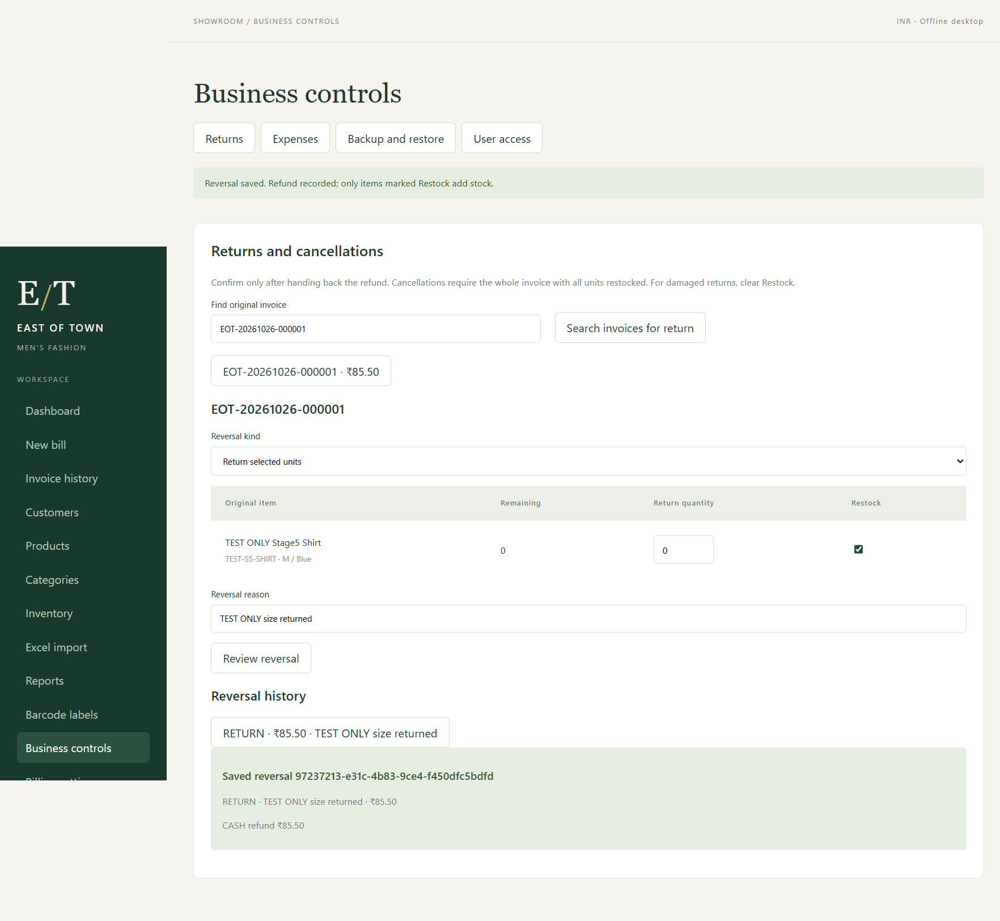

### Record expenses and view monthly profit/loss

1. Open **Business controls → Expenses**. Choose a category or add one. Enter amount, date, payment method and description, then **Save expense**.
2. Record operating costs such as rent, salaries and electricity. Do not enter stock purchases here; product cost is already counted when sold.
3. To correct an error, enter a void reason, click **Void expense**, confirm, then create a replacement. The original remains for audit.
4. Open **Reports**, choose **Monthly net profit / loss**, select This month or a custom full-month range and click **View report**. Export Excel or PDF if required.
5. Positive net profit/loss is profit; negative is loss. Blank/Unknown profit means historical product costs are incomplete. Enter reliable costs before selling. Results depend on recording all expenses; unrecorded costs are not included. Returns and expenses follow their displayed dates.

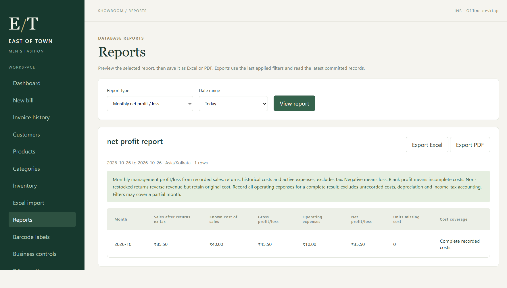

### Reset a billing-user password

Open **Business controls → User access**. Select the billing user, enter a new password of at least 12 characters, and click **Reset billing password**. Communicate it directly to that user. Their existing sessions end; they sign in using the new password. Administrator password recovery still uses the saved one-time recovery code. Activate/deactivate or change roles here; your own administrator cannot be disabled/demoted. Create new accounts from **Users**.

### Prepare a WhatsApp receipt

Open a saved invoice after checkout, from Invoice history, or from customer history. Under **Share purchase receipt**, enter the full phone number including country code, digits only (for example country code 91 followed by the customer's Indian number). Verify the recipient agrees. Select PDF or PNG and click **Save and open WhatsApp**. Confirm the recipient, choose where to save the file, then attach it to the opened WhatsApp chat, review and send. This manual fallback does not automatically attach/send or confirm delivery. Stage 6 also offers Windows Share with the file included, described below. Long receipts need PDF. Internet and your WhatsApp sign-in are required for sending; billing and local PDF creation work offline.

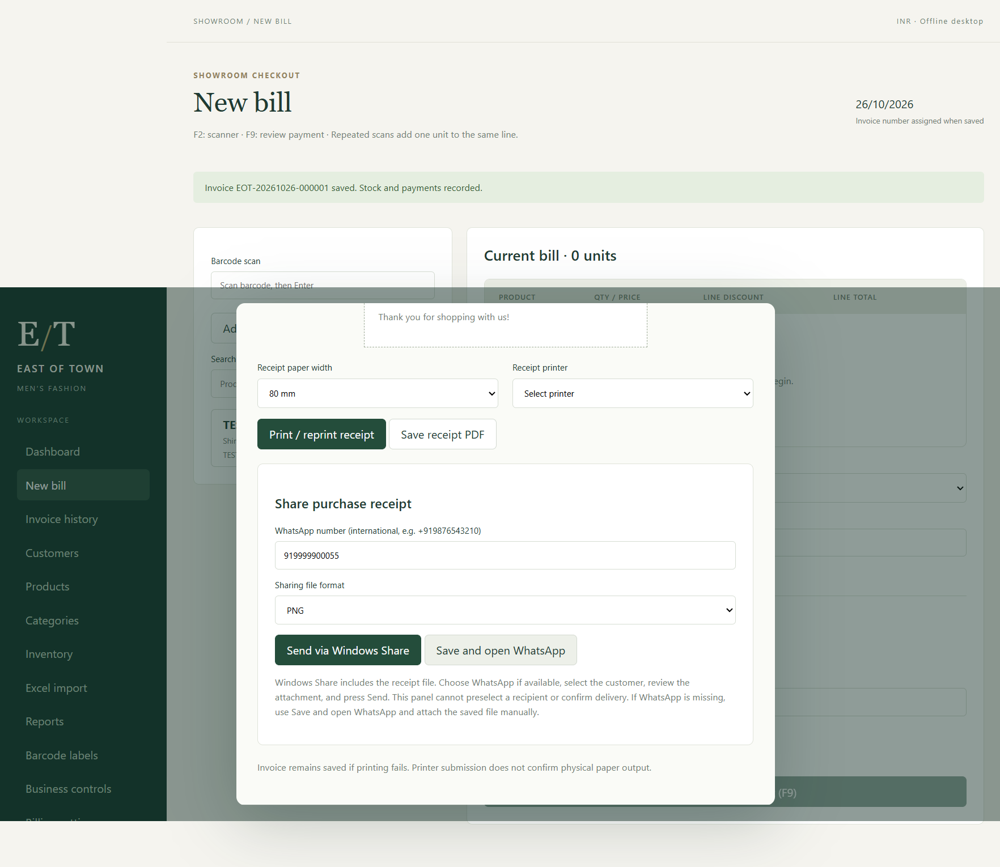

### Back up and restore

Open **Business controls → Backup and restore**. Choose a backup folder, set an interval in hours (for example 24 for daily while the app is open; 0 disables it), and retain at least two copies. Click **Save backup settings**, then **Back up now** and confirm a verified-backup path appears. Use an external secure location for protection against disk failure. Scheduled checks run while the app is open, not when the PC is off.

For restore, choose **Select backup and prepare restore**, select the .db backup and confirm replacement of current data. The service validates it and preserves a backup. Close and restart the application when instructed. New business writes are blocked until restart or Cancel pending restore. Sign in with credentials from the backup. Check invoices, payments/refunds, expenses, customer totals and stock. A rescue-*.db copy of pre-restore records remains in the data folder. Never delete your only good database or edit migration hashes to force a restore. Detailed recovery steps are in STAGE_5.md.

**Export database JSON** is for future migration and includes account password hashes/customer information; keep it and all backups securely. It is not an automatic cloud upload.

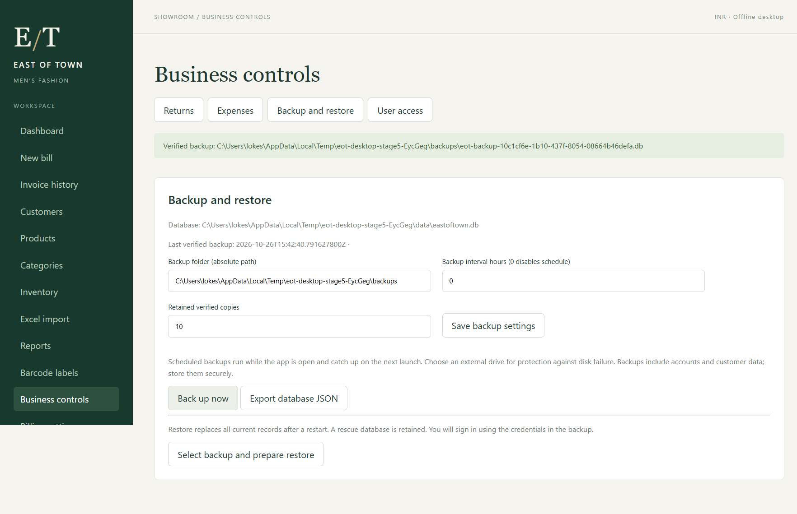

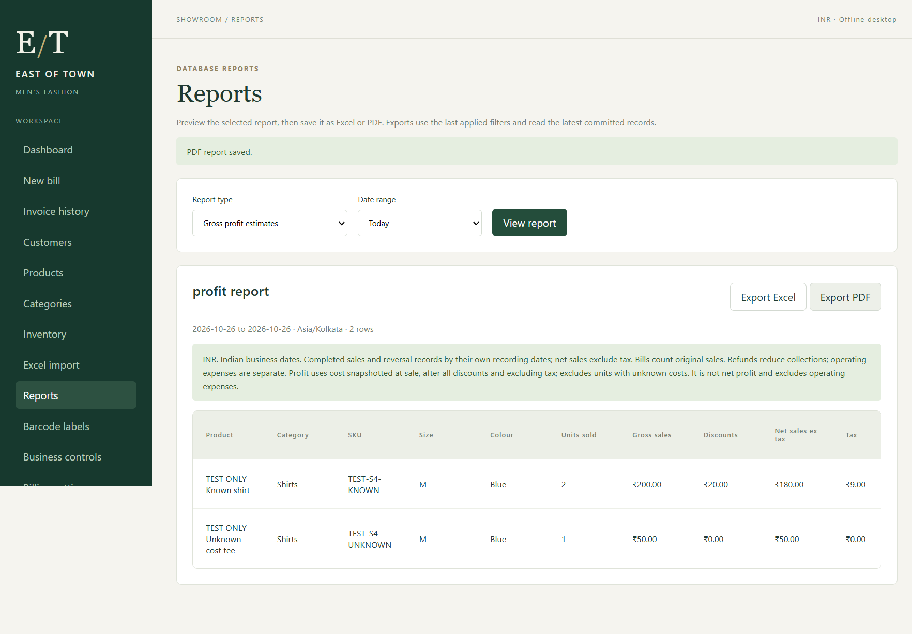

### Requests retained for later approval

Administrator billing-user password reset, INR/% discounts and monthly net profit/loss were implemented in Stage 5. Barcode label dimensions/orientation remain unchanged until shopkeeper approval. Stage 6 adds the requested Windows Share attachment, customer phone validation and live line totals below. Enter tax rates as plain numbers such as `5`, without `%`.

## Stage 6 operating changes

### Create or correct a customer's phone

Open **Customers → Add customer**, or **New Bill → Create customer**. Choose **Phone country / code** (India +91 is the default) and enter the national mobile without its country code. For India enter exactly ten digits beginning 6, 7, 8 or 9. A nine-digit number cannot be saved. Other countries use their own validated mobile numbering plans. The saved international contact is shown with +country code.

Existing invalid numbers show **Invalid saved mobile — administrator correction required** in Customers. As administrator, open that customer's **Purchase history → Correct customer details**, select the right country and enter the complete mobile. Save and confirm that purchase history remains. Old invoice details stay as recorded at the time of sale; sharing uses the corrected current contact. A valid format does not prove the number belongs to the customer—confirm it with them.

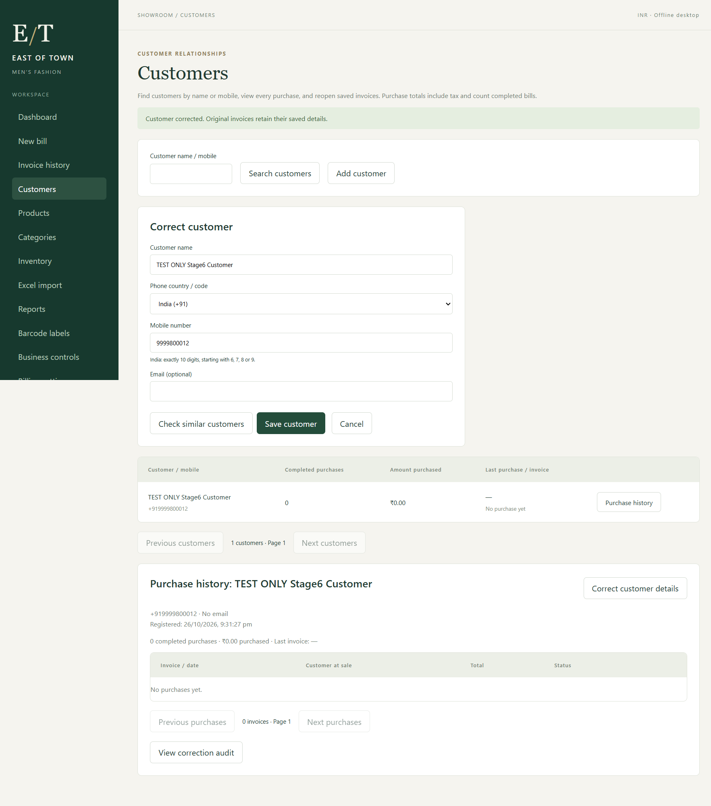

### Check live bill totals

Add a product. **QTY / PRICE** retains its per-item price. **LINE TOTAL** updates automatically when quantity, line discount or bill discount changes, including configured tax. It briefly shows Updating while the backend checks the cart. The live subtotal, combined discounts, tax and payable amount match the payment review. For a ₹100 item, quantity 2, 10% line discount, 5% bill discount and 5% tax, the line total is ₹179.55.

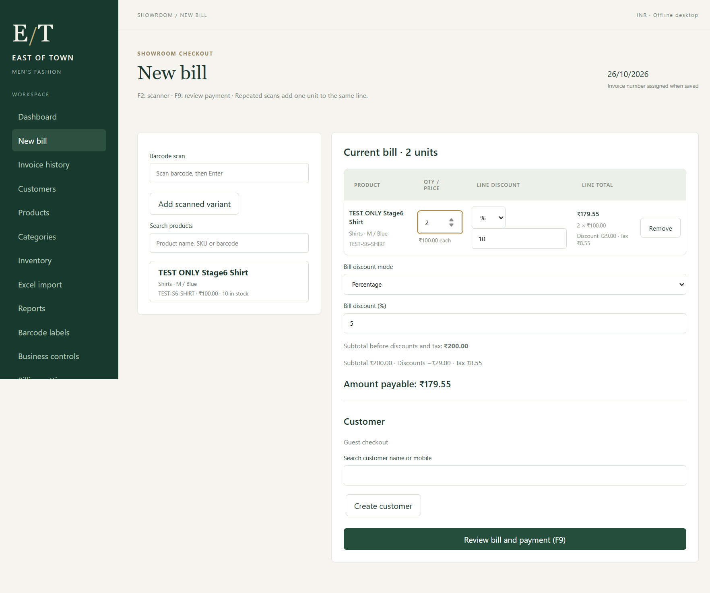

### Share an attached receipt through Windows

Open a saved invoice from checkout, Invoice history or Customer purchase history. Choose PDF or PNG and click **Send via Windows Share**, then confirm. Windows Share opens with the actual receipt file. Select WhatsApp if it appears, choose the correct customer, inspect the attachment and press Send. The number field does not select the recipient inside Windows Share; you choose them in WhatsApp. Close the small sharing window when finished.

If WhatsApp does not appear, try the other file format or use **Save and open WhatsApp**. This fallback requires a valid international number, saves the receipt and opens the chat; attach the file manually. The app never claims delivery. Sending needs internet and your WhatsApp login; billing and file generation work offline. Long receipts require PDF. No paid API or automated Send is configured. Generated sharing-cache files expire after seven days; user-saved copies are not removed.

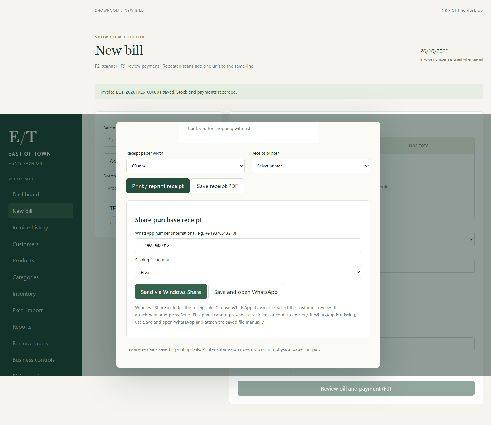

See RELEASE.md for Windows installation, upgrade, persistent-data/backup and signing requirements. Stage 6 physical printer, scanner, reboot and real WhatsApp acceptance must be completed on the shop devices.
